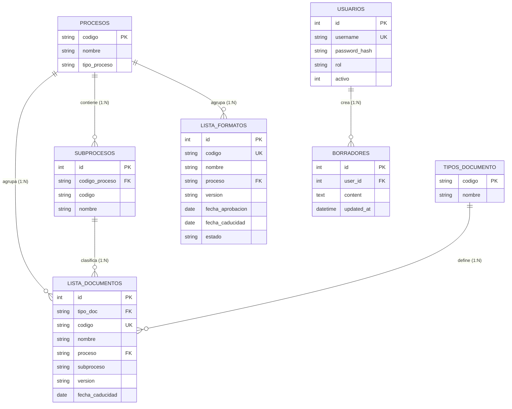

# Sistema Web de Gestión de Calidad (SGC) con IA


Aplicación web que ayuda a crear, estandarizar y mantener vigentes los documentos de un Sistema de Gestión de la Calidad: procedimientos, instructivos, formatos y documentos institucionales. Incluye formularios guiados, codificación automática, asistencia con IA y generación de archivos Word con el formato de la organización.

Es un prototipo funcional desarrollado como proyecto de grado, pensado para evaluarse y servir de base a futuros desarrollos.

---

## Por qué existe

En la gestión tradicional de un SGC es común encontrar:

- Errores al transcribir y dar formato a los documentos a mano.
- Procedimientos que se rehacen varias veces antes de quedar listos.
- Documentos que no siguen el manual de identidad de la institución.
- Versiones antiguas circulando en los puestos de trabajo.

La aplicación busca reducir esos problemas centralizando el proceso. Además, apoya el numeral 7.5 de la norma ISO 9001:2015 (información documentada): ayuda a identificar cada documento (código, título, versión y fecha), a mantener un formato normalizado y a controlar accesos y trazabilidad de la elaboración, revisión y aprobación.

---

## Qué puede hacer

- **Acceso por roles.** Cada usuario ve únicamente lo que su perfil necesita.
- **Listado maestro.** Crear, editar, consultar y dar de baja documentos y formatos, con control de fechas y versiones. También se pueden importar y exportar datos en Excel.
- **Formulario guiado de procedimientos.** El usuario completa el documento por secciones, con validaciones que evitan dejar campos obligatorios vacíos. El sistema genera un `.docx` con tablas, encabezados y pie de página. Los borradores se pueden guardar y retomar después.
- **Nomenclaturas.** Catálogo de macroprocesos, procesos, subprocesos y tipos de documento, para que los códigos sigan siempre la misma regla.
- **Asistencia con IA.** Usa Google Gemini para ayudar a redactar objetivos, alcances y definiciones. El administrador puede ajustar los prompts y activar o desactivar la IA, de forma global o por sección. También incluye un configurador de estilos (tipografía, colores y márgenes) y scripts en Python para normalizar borradores antiguos.
- **Indicadores.** Una API de solo lectura (`/api/bi/*`), protegida con API Key, alimenta tableros de Power BI con vencimientos y métricas por proceso.

---

## Roles

| Rol | Permiso | Qué puede hacer |
|-----|:-------:|-----------------|
| Administrador | Global (`Admin`) | Administra el listado maestro, hace cargas masivas, gestiona usuarios, nomenclaturas, estilos y parámetros de IA. |
| Funcionario / Editor | `RW` (`User`) | Crea y edita documentos con los formularios, usa la asistencia de IA y genera archivos `.docx`. |
| Usuario de consulta | `R` (`Read`) | Consulta documentos aprobados y catálogos. No puede modificarlos. |

La configuración crítica (estilos, nomenclaturas, reglas de negocio y parámetros de IA) está reservada al Administrador.

---

## Reglas de codificación

Cada documento sigue esta estructura:

```text
[TipoDocumento]-[Proceso]-[Subproceso]-[Consecutivo]
```

Por ejemplo, `PR-AS-E-101` se lee así:

```text
PR-AS-E-101
│  │  │  └── Consecutivo: 101
│  │  └───── Subproceso: E
│  └──────── Proceso: AS
└─────────── Tipo de documento: PR (Procedimiento)
```

Otros ejemplos: `FR-GH-X-002` (formato de Gestión de Talento Humano) e `IN-GT-S-003` (instructivo de Gestión de TI).

Algunas convenciones más:

- Los códigos de documento van en mayúsculas y con guiones.
- Las tablas de la base de datos usan `snake_case` (por ejemplo, `lista_documentos`).
- La interfaz y la documentación están en español.

Un procedimiento generado por el sistema debe incluir, como mínimo: encabezado institucional con código, versión y paginación; objetivo, alcance, responsables y definiciones; descripción de actividades; documentos y registros relacionados; anexos; control de versiones; y una matriz de firmas para elaboración, revisión y aprobación.

Cada cambio (creación, edición o eliminación) se guarda de inmediato en el listado maestro, con su historial de versiones, para que nadie use un documento desactualizado sin darse cuenta.

---

## Arquitectura y tecnologías

El backend está organizado en módulos de Flask (Blueprints): `auth`, `document_app`, `maestros`, `admin`, `admin_ia` y `api_bi`. El control de acceso sigue el modelo RBAC.

| Capa | Tecnología | Para qué se usa |
|------|-----------|-----------------|
| Backend | Python 3.10+ con Flask | Lógica de negocio, rutas y módulos. |
| Base de datos | SQLite | Almacenamiento relacional. La migración a PostgreSQL o MySQL está prevista. |
| Inteligencia artificial | Google Gemini API (`gemini-1.5-flash`) | Asistencia en la redacción, con control de cuotas, timeouts y limpieza de respuestas. |
| Documentos Word | `python-docx`, `docx-mailmerge`, `lxml` | Generación y estilizado de archivos `.docx`. |
| Hojas de cálculo | `pandas`, `openpyxl` | Importación y exportación de maestros en Excel. |
| Frontend | HTML5, CSS3, JavaScript vanilla, Font Awesome | Interfaz responsive. |
| Analítica | Microsoft Power BI | Tablero de vigencias conectado a la API. |
| Repositorio institucional | Microsoft SharePoint | Publicación final de documentos. La integración está en la hoja de ruta. |
| Entorno de desarrollo | Google Antigravity | IDE basado en agentes, usado para construir el prototipo. |

---

## Modelo de datos



- `lista_documentos`: el listado maestro (identidad, título, versión, vigencia y responsable).
- `lista_formatos`: estructura y metadatos de las plantillas de formatos.
- `tipos_documento`: procedimientos, instructivos, formatos y documentos institucionales.
- `procesos` y `subprocesos`: la jerarquía de macroprocesos y procesos.
- `usuarios` y `borradores`: cuentas con su rol y los borradores de cada usuario.

También existe una tabla `document_styles` con la configuración visual de los documentos.

---

## Flujo de trabajo

1. El área usuaria inicia un documento y el sistema valida su codificación.
2. La persona completa el formulario por secciones, y si lo necesita, pide ayuda a la IA para redactar.
3. El sistema revisa los campos obligatorios y aplica los estilos, tablas y márgenes.
4. Se genera el Word y el documento queda registrado en el listado maestro.
5. Los borradores antiguos pueden normalizarse con los scripts de Python y el agente de IA.
6. La API de Power BI toma la información para mostrar vencimientos, alertas y métricas por proceso.

---

## Instalación y ejecución

**Requisitos:** Python 3.10 o superior. Internet solo si vas a usar la integración con Gemini.

**1. Clona el repositorio y entra a la carpeta:**

```bash
git clone <URL_DEL_REPOSITORIO>
cd generador_docs_app
```

**2. Crea y activa un entorno virtual:**

```bash
# Windows
python -m venv .venv
.venv\Scripts\activate

# Linux / macOS
python3 -m venv .venv
source .venv/bin/activate
```

**3. Instala las dependencias:**

```bash
pip install -r requirements.txt
```

**4. Configura las variables de entorno.** Copia la plantilla y edítala con tus propios valores:

```bash
# Windows
copy .env.example .env

# Linux / macOS
cp .env.example .env
```

```env
SECRET_KEY=cambiar_por_una_clave_segura
POWERBI_API_KEY=cambiar_por_una_clave_para_power_bi
AI_API_KEY=tu_api_key_de_gemini
AI_BASE_URL=https://generativelanguage.googleapis.com/v1beta/models/gemini-1.5-flash:generateContent
AI_MODEL=gemini-1.5-flash
```

No subas el archivo `.env` al repositorio.

**5. Inicializa la base de datos.** Este paso crea las tablas y carga los datos iniciales (usuarios de demostración, nomenclaturas y estilos predeterminados):

```bash
python init_db.py
```

**6. Ejecuta la aplicación:**

```bash
python main.py
```

Después abre `http://127.0.0.1:5000` en tu navegador.

En Windows también puedes usar `START_APP.bat`, que revisa el entorno virtual, instala lo que falte y levanta el servidor.

### Usuarios de demostración

`init_db.py` crea dos cuentas de prueba, una de Administrador y otra de Usuario, para que puedas explorar la aplicación. Son solo para uso local. Cámbialas o elimínalas antes de desplegar.

---

## Estructura del proyecto

```
generador_docs_app/
├── main.py                 # Punto de entrada Flask y rutas del menú
├── auth.py                 # Autenticación, sesiones y decoradores RBAC
├── document_app.py         # Formulario guiado, IA y ensamblador Word
├── maestros.py             # Listado maestro (CRUD y carga masiva en Excel)
├── admin.py                # Usuarios, roles, nomenclaturas y estilos
├── admin_ia.py             # Configuración de prompts y directivas de IA
├── api_bi.py               # API REST protegida para Power BI
├── standardizer_tool.py    # Normalización de formatos documentales
├── init_db.py              # Creación e inicialización de la base de datos
├── db.py                   # Conexión centralizada a SQLite
├── static/                 # CSS, JavaScript e imágenes
├── templates/              # Plantillas Jinja2 (login, formularios, admin, menús)
├── plantillas_descargas/   # Plantillas Word descargables
├── utils/                  # Formateadores de Word (procedimientos, formatos, XML)
├── requirements.txt        # Dependencias de Python
├── .env.example            # Plantilla de variables de entorno
└── README.md
```

---

## Estado del proyecto y próximos pasos

Es un prototipo funcional. Incluye las pantallas, los flujos, el modelo de datos, la generación de Word y las integraciones con Gemini y Power BI.

Para llevarlo a producción, los pasos recomendados son:

1. Migrar de SQLite a PostgreSQL o MySQL, con SQLAlchemy y Alembic para las migraciones.
2. Desplegar con Gunicorn o uWSGI detrás de Nginx, con HTTPS.
3. Contenerizar con Docker (`Dockerfile` multi-stage y `docker-compose.yml`).
5. Mover la generación de documentos extensos e importaciones masivas a tareas asíncronas, con Celery y Redis.
6. Reemplazar las credenciales de demostración, sacar los secretos del código y documentar el mecanismo de sesión.
7. Definir el DDL SQL final y documentar los endpoints HTTP.

---
