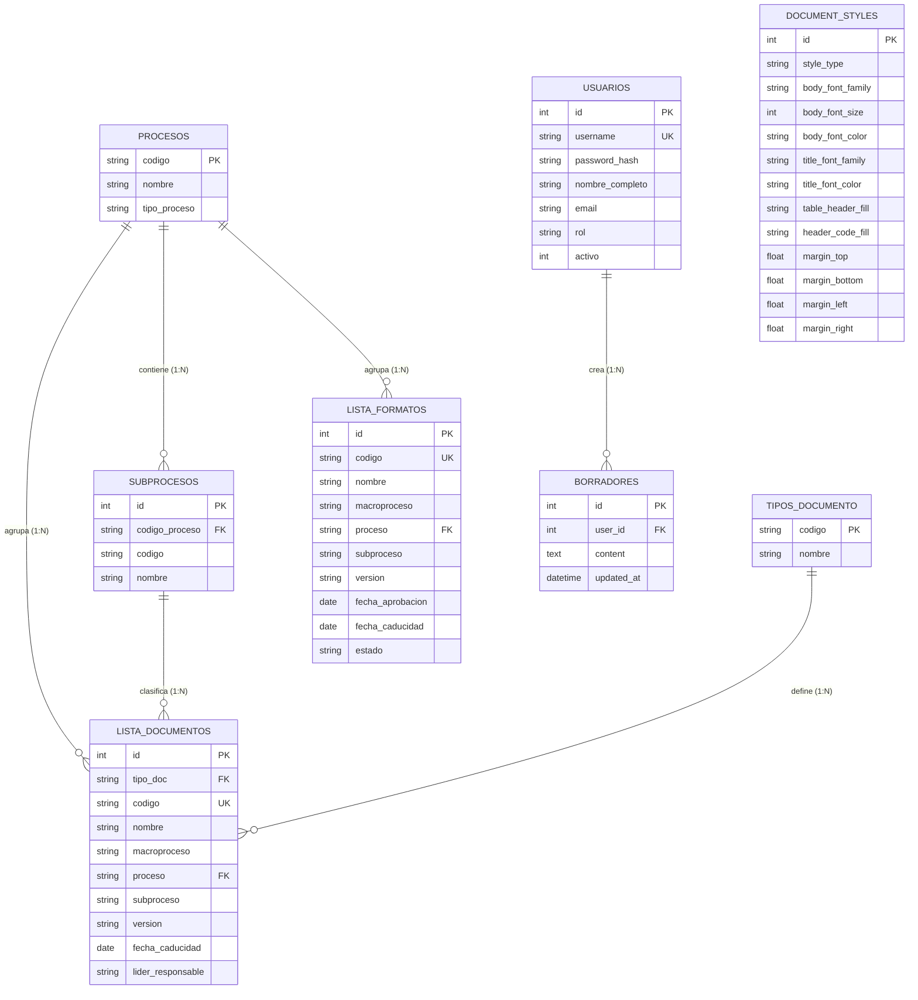

# Sistema Web de Gestión de Calidad (SGC) y Generador de Documentos Institucionales con IA


Aplicación web empresarial y prototipo tecnológico de alta fidelidad diseñado para optimizar, estandarizar y gobernar el ciclo de vida completo de la información documentada institucional (Procedimientos, Instructivos, Formatos y Documentos Institucionales). 

El sistema integra asistencia inteligente mediante **Google Gemini**, motores de automatización documental con plantillas dinámicas de **Microsoft Word**, administración de maestros con **Microsoft Excel** y un endpoint de integración analítica para **Microsoft Power BI**.

---

## 1. Descripción del Proyecto y Problemática

En la gestión tradicional de un Sistema de Gestión de Calidad (SGC), las organizaciones enfrentan frecuentes fallas operativas:
- Errores humanos en la transcripción y formateo manual.
- Reprocesos en la redacción y revisión técnica de procedimientos.
- Inconsistencias de diseño y tipografía respecto al manual de identidad institucional.
- Pérdida de control de versiones y uso de documentos obsoletos o caducados en los puestos de trabajo.

### Alineación Normativa (ISO 9001:2015)
Para mitigar estas brechas, la aplicación asegura el cumplimiento riguroso del **numeral 7.5 (Información documentada)** de la norma **ISO 9001:2015**:
- **7.5.2 Creación y actualización:** Asegura la correcta identificación, descripción (código, título, versión, fecha) y formato institucional normalizado.
- **7.5.3 Control de la información documentada:** Garantiza disponibilidad en los puntos de uso, control de accesos, protección contra pérdida de integridad y trazabilidad formal de elaboración, revisión y aprobación.

---

## 2. Módulos y Funcionalidades del Sistema

La arquitectura funcional de la plataforma se compone de seis módulos principales:

```
┌──────────────────────────────────────────────────────────────────────────┐
│             SISTEMA WEB DE GESTIÓN DE CALIDAD (SGC) CON IA               │
└────────────────────────────────────┬─────────────────────────────────────┘
                                     │
     ┌───────────────────────────────┼──────────────────────────────┐
     ▼                               ▼                              ▼
┌──────────────┐             ┌──────────────┐             ┌────────────────┐
│ 1. Seguridad │             │ 2. Listados  │             │ 3. Generación  │
│    y Acceso  │             │    Maestros  │             │    Documental  │
│    (RBAC)    │             │ (Docs & FMT) │             │  (Word/.docx)  │
└──────────────┘             └──────────────┘             └────────────────┘
     │                               │                              │
     ▼                               ▼                              ▼
┌──────────────┐             ┌──────────────┐             ┌────────────────┐
│ 4. Gestión   │             │ 5. Motor IA  │             │ 6. Indicadores │
│    Nomencla- │             │    y Estilos │             │    y BI        │
│    turas     │             │ (Gemini API) │             │   (Power BI)   │
└──────────────┘             └──────────────┘             └────────────────┘
```

1. **Módulo de Autenticación y Perfiles (RBAC):**
   - Control de acceso seguro mediante credenciales encriptadas con algoritmos criptográficos (`scrypt`).
   - Redirección y menús dinámicos diferenciados según el rol del usuario (Administrador vs. Usuario operativo).

2. **Módulo de Listados Maestros (Documentos y Formatos):**
   - Inventario centralizado con operaciones CRUD completas (creación, edición, consulta y baja).
   - Búsqueda y filtrado individual avanzado por proceso, código, tipo y estado de vigencia.
   - Carga y descarga masiva mediante plantillas normalizadas de **Microsoft Excel (`.xlsx`)**.
   - Control estricto de fechas de emisión, vencimiento y control de versionamiento.

3. **Módulo de Generación y Estandarización de Procedimientos:**
   - Formulario guiado paso a paso con validaciones en tiempo real para evitar omisiones de campos obligatorios.
   - Generación en caliente de archivos editables **`.docx` (Microsoft Word)** preservando estructuras de tablas, encabezados dinámicos, matrices de responsabilidades y pie de página.
   - Sistema de guardado y recuperación de borradores para continuar el trabajo posteriormente.

4. **Módulo de Gestión de Nomenclaturas:**
   - Catálogo institucional de Macroprocesos, Procesos y Subprocesos.
   - Configuración de tipos de documento y sus reglas asociadas.
   - Garantía de unicidad en la codificación según las convenciones de la organización.

5. **Módulo de Estilos e Inteligencia Artificial:**
   - **Asistente Google Gemini (`gemini-1.5-flash`)**: Asistencia contextual para parafrasear y redactar objetivos formales, alcances, definiciones y coherencia en registros de tablas de actividades.
   - **Administración de Prompts**: Panel administrativo para ajustar prompts del sistema e instrucciones específicas por tipo de documento y sección.
   - **Interruptores Granulares**: Activación/desactivación global o por sección de la IA.
   - **Configurador Dinámico de Estilos**: Personalización de tipografías (ej. Calibri), tamaños de fuente, colores corporativos, rellenos de tablas y márgenes normalizados (2.5 cm).

6. **Módulo de Indicadores y Analítica (Power BI):**
   - API REST dedicada (`/api/bi/*`) con acceso de solo lectura y autenticación por API Key / Token en cabeceras o parámetros.
   - Endpoints optimizados para consumo directo desde **Microsoft Power BI**: monitoreo de vigencias, documentos próximos a vencer y métricas por proceso.

---

## 3. Roles y Control de Acceso (Matriz RBAC)

| Rol de Usuario | Nivel de Acceso | Responsabilidades y Alcance en el Sistema |
| :--- | :--- | :--- |
| **Administrador** | Global (`Admin`) | Acceso total al sistema. Gestiona el Listado Maestro (crear, editar, eliminar), ejecuta cargas masivas mediante Excel, configura usuarios, nomenclaturas, reglas de negocio, estilos visuales y parámetros del agente de IA. |
| **Funcionario / Editor** | Lectura y Escritura (`User`) | Acceso a los formularios guiados, redacción de documentos, uso de la asistencia de IA, consulta de maestros y generación de archivos `.docx`. |
| **Usuario de Consulta** | Solo Lectura (`Read`) | Visualización de procedimientos aprobados, descarga de formatos vigentes y consulta de catálogos sin facultades de alteración. |

---

## 4. Reglas de Negocio y Estandarización Documental

### Regla de Codificación Obligatoria

Todo documento registrado o generado en el sistema debe seguir de manera estricta la siguiente convención alfanumérica:

$$\text{[TipoDocumento]}-\text{[Proceso]}-\text{[Subproceso]}-\text{[Consecutivo]}$$

- **Ejemplos prácticos:**
  - `PR-GA-X-301`: Procedimiento — Gestión Administrativa — Subproceso Específico — Consecutivo 301.
  - `FR-GH-X-614`: Formato — Gestión de Talento Humano — Subproceso Específico — Consecutivo 614.
  - `IN-GT-S-502`: Instructivo — Gestión de TI — Seguridad de la Información — Consecutivo 502.

### Estructura Mínima Exigida en Procedimientos

Cada documento de tipo procedimiento generado debe integrar obligatoriamente:
1. **Encabezado institucional normalizado:** Tabla con código oficial, versión vigente, título institucional y paginación automática (`Página X de Y`).
2. **Cuerpo del documento:**
   - Objetivo formal (redactado en infinitivo).
   - Alcance (delimitación clara de inicio, fin y áreas involucradas).
   - Periodicidad de ejecución y Responsables principales.
   - Normatividad y políticas de referencia.
   - Definiciones y glosario técnico.
3. **Descripción de Actividades:** Matriz estructurada con número de paso, responsable del rol, descripción detallada de la acción y registros o formatos asociados.
4. **Documentos y Registros Relacionados:** Matriz de trazabilidad documental institucional y externa.
5. **Lista de Anexos:** Identificación y descripción de soportes aplicables.
6. **Control de Versión:** Historial de cambios con versión, fecha y resumen de modificaciones.
7. **Matriz de Firmas:** Registro de Elaboración, Revisión y Aprobación (nombre, cargo y fecha).

---

## 5. Modelo de Datos (Esquema Relacional)

La base de datos relacional almacena la configuración de calidad, usuarios, borradores y maestros institucionales:



---

## 6. Arquitectura y Stack Tecnológico

- **Backend:** Python 3 con el microframework **Flask** y arquitectura modular basada en Blueprints (`auth`, `document_app`, `maestros`, `admin`, `admin_ia`, `api_bi`).
- **Base de Datos:** **SQLite** estructurada, con migración transparente para entornos corporativos (PostgreSQL / MySQL).
- **Inteligencia Artificial:** **Google Gemini API (`gemini-1.5-flash`)** con integración HTTP segura, manejo de cuotas, timeouts y sanitización de respuestas.
- **Procesamiento de Documentos Word:** `python-docx`, `docx-mailmerge` y manipulación XML de bajo nivel con `lxml` para preservar encabezados complejos y estilos institucionales.
- **Manejo de Hojas de Cálculo:** `pandas` y `openpyxl` para el procesamiento bidireccional de maestros Excel.
- **Frontend:** HTML5 semántico, CSS3 moderno con variables de diseño corporativo, JavaScript vanilla y tipografía e iconografía institucional (Font Awesome).
- **Analítica de Negocios:** **Microsoft Power BI** conectado a la API protegida por API Key.
- **Entorno de Desarrollo:** Diseñado y optimizado bajo la metodología de agentes en **Google Antigravity**.

---

## 7. Flujos de Trabajo Principales

```
1. Solicitud & Codificación
   Usuario inicia nuevo documento ──► Sistema valida nomenclatura (PR-XX-X-000)
                                                    │
2. Diligenciamiento Guiado                          ▼
   Formulario por secciones ────────► Asistencia IA en redacción (Gemini)
                                                    │
3. Revisión & Formateo Automático                  ▼
   Validación de campos ────────────► Motor aplica estilos, tablas y márgenes
                                                    │
4. Generación & Descarga                            ▼
   Exportación a Word (.docx) ──────► Almacenamiento y registro en Maestro
                                                    │
5. Monitoreo & BI                                   ▼
   API REST (/api/bi/*) ────────────► Tablero Power BI de vigencias y alertas
```

---

## 8. Instalación y Puesta en Marcha

### Requisitos Previos
- **Python 3.10** o superior instalado en el sistema.
- Acceso a internet (opcional, requerido solo si se usa la integración con Google Gemini).

### Paso 1: Clonar el Repositorio
```bash
git clone <URL_DEL_REPOSITORIO>
cd generador_docs_app
```

### Paso 2: Crear y Activar el Entorno Virtual
```bash
# En Windows:
python -m venv .venv
.venv\Scripts\activate

# En Linux / macOS:
python3 -m venv .venv
source .venv/bin/activate
```

### Paso 3: Instalar Dependencias
```bash
pip install -r requirements.txt
```

### Paso 4: Configurar Variables de Entorno
Copia la plantilla `.env.example` para generar tu archivo `.env` local:
```bash
# En Windows (PowerShell / CMD):
copy .env.example .env

# En Linux / macOS:
cp .env.example .env
```

Edita el archivo `.env` con tus parámetros:
```env
# Clave secreta para la sesión de Flask (cambiar en producción)
SECRET_KEY=clave_secreta_para_flask_cambiar_en_produccion

# Token para autorización en endpoints de Power BI
POWERBI_API_KEY=tu_clave_secreta_para_power_bi

# Credenciales de Google Gemini (opcional para funciones inteligentes)
AI_API_KEY=tu_api_key_de_gemini_aqui
AI_BASE_URL=https://generativelanguage.googleapis.com/v1beta/models/gemini-1.5-flash:generateContent
AI_MODEL=gemini-1.5-flash
```

### Paso 5: Inicializar la Base de Datos
El proyecto incluye un script de inicialización con usuarios demo, nomenclaturas y estilos predeterminados:
```bash
python init_db.py
```

---

## 9. Usuarios de Demostración

Para pruebas funcionales y evaluación del sistema, la base de datos se inicializa con dos cuentas de prueba:

| Usuario | Contraseña | Rol | Alcance y Acceso |
| :--- | :--- | :--- | :--- |
| `admin` | `admin123` | **Administrador** | Control total de maestros, usuarios, configuración de estilos, prompts de IA y descargas. |
| `usuario` | `user123` | **Usuario** | Diligenciamiento de formularios, guardado de borradores y generación de documentos Word. |

---

## 10. Ejecución de la Aplicación

### Opción A (Acceso rápido en Windows):
Haga doble clic en el archivo ejecutable por lotes:
```
START_APP.bat
```
El script validará el entorno virtual, instalará dependencias faltantes y levantará el servidor automáticamente.

### Opción B (Línea de comandos):
```bash
python main.py
```

Acceda a la aplicación desde su navegador web en:
```
http://127.0.0.1:5000
```

---

## 11. Estructura del Proyecto

```
generador_docs_app/
│
├── main.py                     # Punto de entrada de la aplicación Flask y rutas del menú
├── auth.py                     # Módulo de autenticación, sesiones y decoradores RBAC
├── document_app.py             # Formulario guiado, invocación de IA y ensamblador Word
├── maestros.py                 # Gestión de maestros (Excel masivo, CRUD de documentos y formatos)
├── admin.py                    # Administración de usuarios, roles, nomenclaturas y estilos
├── admin_ia.py                 # Panel de configuración de prompts y directivas de IA
├── api_bi.py                   # API REST protegida para integración con Power BI
├── standardizer_tool.py        # Herramienta de normalización de formatos documentales
├── init_db.py                  # Script de creación e inicialización de la base de datos
├── db.py                       # Conexión centralizada a la base de datos SQLite
│
├── static/                     # Recursos visuales estáticos
│   ├── css/style.css           # Hoja de estilos institucionales y responsive design
│   ├── js/main.js              # Lógica de cliente (asincronía, tablas dinámicas, validaciones)
│   └── img/logo.svg            # Isotipo / logotipo institucional
│
├── templates/                  # Plantillas Jinja2 organizadas modularmente
│   ├── base.html               # Estructura base compartida
│   ├── document_form.html      # Formulario dinámico de generación documental
│   ├── preview.html            # Vista previa y confirmación antes de compilar
│   ├── admin/                  # Vistas de gestión de usuarios, estilos y nomenclaturas
│   ├── auth/                   # Pantallas de login y recuperación
│   ├── menu/                   # Menús principales para usuarios y administradores
│   └── plantillas/             # Interfaz de consulta y descarga de plantillas oficiales
│
├── plantillas_descargas/       # Repositorio de plantillas Word oficiales descargables
├── utils/                      # Formateadores avanzados de Microsoft Word (DOCX)
│   ├── docx_formatter.py       # Estilizador de Procedimientos (encabezados, fuentes, márgenes)
│   ├── formats_formatter.py    # Formateador de Formatos y registros
│   └── docx_styler.py          # Utilidades compartidas de XML y tablas
│
├── requirements.txt            # Dependencias oficiales del entorno Python
├── .env.example                # Plantilla de variables de entorno segura para repositorios
└── README.md                   # Memoria técnica y documentación principal del sistema
```

---

## 12. Hoja de Ruta y Producción (Roadmap)

Para el despliegue del prototipo en una infraestructura de producción empresarial de alta disponibilidad, se contemplan las siguientes fases técnicas:

1. **Migración del Motor de Base de Datos:**
   - Transicionar de SQLite a **PostgreSQL** o **MySQL Enterprise**, aprovechando SQLAlchemy u ORM equivalente para la gestión de pools de conexiones y migraciones automáticas (`Alembic`).
2. **Servidor de Aplicaciones y Producción WSGI:**
   - Desplegar la aplicación detrás de **Gunicorn** / **uWSGI** con un proxy inverso **Nginx** que gestione certificados SSL/TLS (HTTPS) y balanceo de carga.
3. **Contenerización (Docker & Kubernetes):**
   - Creación de imágenes Docker ligeras (`Dockerfile` multi-stage y `docker-compose.yml`) para orquestar la aplicación web, base de datos y tareas asíncronas.
4. **Integración con Gestores Documentales Cloud:**
   - Conectar la salida del generador con repositorios institucionales en la nube (Microsoft SharePoint API, Google Workspace Drive o Amazon S3) con versionamiento centralizado.
5. **Colas de Tareas Asíncronas:**
   - Incorporar Celery con Redis para la generación en segundo plano de documentos muy extensos o importaciones masivas de catálogos sin bloquear el hilo principal web.

---

## 13. Licencia y Consideraciones

Este proyecto fue desarrollado con fines académicos, de investigación aplicada y demostración técnica para la optimización de Sistemas de Gestión de Calidad (SGC). 

Toda información institucional, logotipos y credenciales han sido higienizados y parametrizados para su publicación segura en repositorios públicos.

